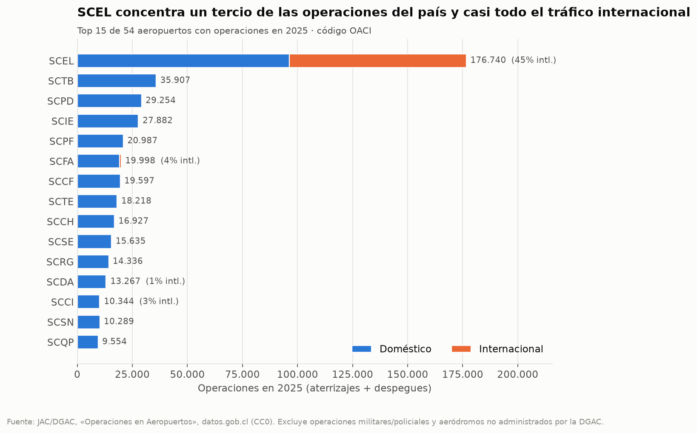
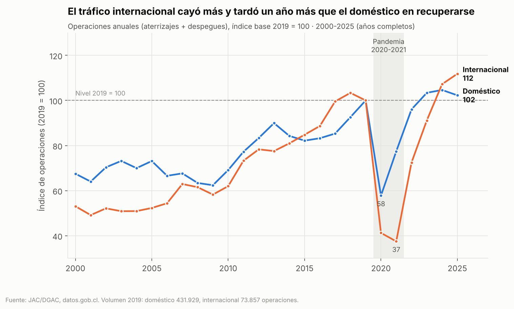
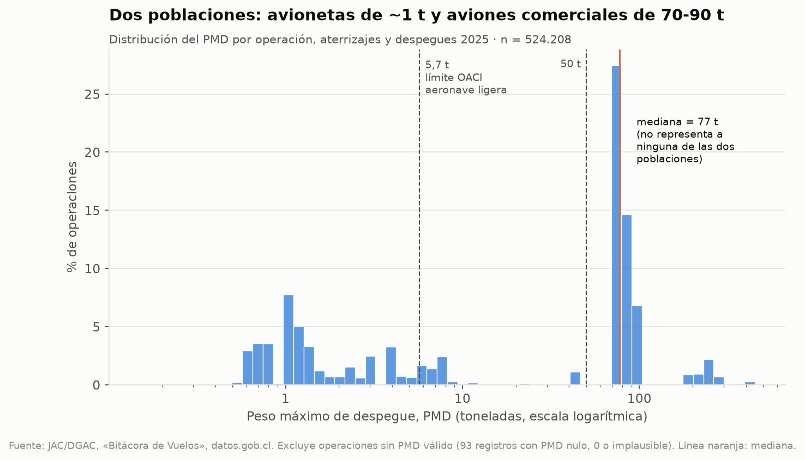
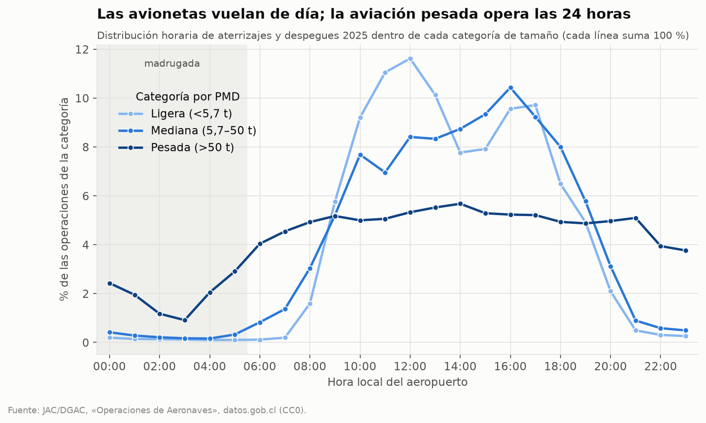
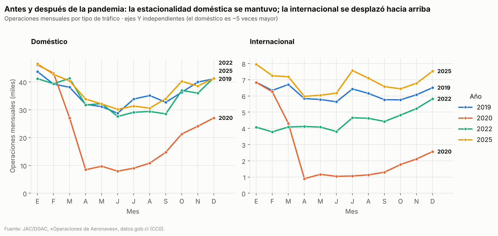

# Evaluación 2 - Visualización de Datos de Transporte

Estudio exploratorio y visual de las **operaciones de aeronaves en aeropuertos de Chile (2000-2026)** a partir de datos abiertos de la Junta de Aeronáutica Civil, desarrollado con Python, Pandas, Matplotlib y Seaborn.

> Todo el análisis está en [`notebooks/evaluacion02.ipynb`](notebooks/evaluacion02.ipynb), que se ejecuta de principio a fin. Este README resume cada etapa y remite a la sección correspondiente del notebook.

## Problema

**Pregunta principal:** ¿Cómo se distribuye y cómo ha evolucionado la actividad aeroportuaria registrada en Chile entre 2000 y 2026 según aeropuerto, tipo de tráfico (doméstico/internacional), tamaño de aeronave y momento del día, y qué patrones temporales la caracterizan?

| | Pregunta secundaria |
|---|---|
| P1 | ¿Qué aeropuertos concentran las operaciones y qué peso tiene el tráfico internacional en cada uno? |
| P2 | ¿Cómo evolucionaron las operaciones domésticas e internacionales entre 2000 y 2025 y cómo se recuperó cada una tras la caída de 2020? |
| P3 | ¿Cómo se distribuyen las operaciones según tamaño de aeronave y hora del día, y difieren esos patrones entre segmentos? |

**H1 (exploratoria):** tras la caída de 2020, el tráfico internacional se recuperó más lentamente que el doméstico respecto de su nivel de 2019.

Análisis preliminar y formulación completos: [`docs/02_analisis_preliminar_y_problema.md`](docs/02_analisis_preliminar_y_problema.md).

## Fuente de datos

| | |
|---|---|
| Conjunto | **Operaciones de Aeronaves** — https://datos.gob.cl/dataset/operaciones-aeronaves |
| Institución | Junta de Aeronáutica Civil (JAC); datos recolectados por la DGAC |
| Licencia | Creative Commons CCZero (dominio público) |
| Actualización | Mensual (≈ día 10 de cada mes, con el mes anterior) |
| Documentación | https://jac-mtt.github.io/jac-docs/docs/series/operaciones_aeroportuarias/ |

| Recurso | Formato | Tamaño | Granularidad | Filas |
|---|---|---|---|---|
| `operaciones-aeropuertos.csv` | CSV UTF-8 | 285 KB | aeropuerto × mes × tipo de tráfico | 16.172 |
| `bitacora-vuelos.parquet` | Parquet (zstd) | 138 MB | una operación (A/D/W) | 11.163.791 |

Periodo cubierto: enero 2000 – septiembre 2026 (descarga del 09-11-2026). Investigación completa de la fuente, metadatos y limitaciones: [`docs/01_investigacion_fuente.md`](docs/01_investigacion_fuente.md).

## Adquisición

Los archivos originales se descargaron desde la fuente oficial el **09-11-2026** con `curl` (PowerShell, Windows) y se guardaron en `data/raw/`:

```powershell
curl.exe -L "https://datos.gob.cl/dataset/d5fac3ed-01c7-43f0-9dc4-8970566bc059/resource/2b7f3fbd-8be8-45e6-8ef5-64eea097528b/download/operaciones-aeropuertos.csv" -o data\raw\operaciones-aeropuertos.csv
curl.exe -L -C - --retry 10 --retry-all-errors "https://datos.gob.cl/dataset/d5fac3ed-01c7-43f0-9dc4-8970566bc059/resource/5bc8842e-d95a-4f8f-8ec6-acfbe700258a/download/bitacora-vuelos.parquet" -o data\raw\bitacora-vuelos.parquet
```

La descarga del parquet se cortó dos veces (`curl: (18) end of response`), por lo que se reanudó con `-C -` (continuar) y `--retry`. Se verificó que el tamaño final coincidiera con el declarado en los metadatos (138.247.225 bytes).

Alternativa multiplataforma incluida en el repositorio:

```bash
python src/descargar_datos.py
```

**Regla de preservación:** `data/raw/` no se edita manualmente. **El parquet no se versiona** (supera el límite de 100 MB por archivo de GitHub) y está en `.gitignore`; quien clone el repositorio debe descargarlo con el script anterior. El CSV original (285 KB) sí está versionado.

## Configuración del entorno

Requisitos: Python 3.11 o superior.

```bash
python -m venv .venv
# Windows (PowerShell)
.venv\Scripts\Activate.ps1
# Linux / macOS
source .venv/bin/activate

pip install -r requirements.txt
```

Dependencias principales: `pandas`, `numpy`, `matplotlib`, `seaborn`, `pyarrow` (lectura de Parquet) y `jupyter`. La lista exacta se registró con `pip freeze > requirements.txt`.

## Estructura del proyecto

```
evaluacion_02_transportes/
├── data/
│   ├── raw/                     # originales (CSV versionado; parquet sólo local)
│   └── processed/
│       ├── operaciones_mensuales_procesado.csv
│       └── bitacora_2025_procesada.parquet
├── notebooks/
│   ├── evaluacion02.ipynb       # notebook principal (ejecutado)
│   └── evaluacion02.py          # mismo notebook en formato texto (jupytext), útil para revisar diffs
├── src/
│   ├── descargar_datos.py       # adquisición reproducible
│   ├── preparacion.py           # carga, limpieza y variables derivadas
│   └── estilo.py                # paleta y estilo común de los gráficos
├── output/figures/              # 6 figuras PNG generadas por el notebook
├── docs/                        # investigación de la fuente y formulación del problema
├── README.md
├── requirements.txt
└── .gitignore
```

## Perfilamiento

*(Notebook §5)* `head`, `tail`, `sample`, `shape`, `columns`, `dtypes`, `info`, `describe`, `nunique` y una tabla de perfil consolidada.

| | CSV | Bitácora |
|---|---|---|
| Registros | 16.172 | 11.163.791 |
| Columnas | 4 | 12 |
| Numéricas | `cnt_operaciones` | `pmd` |
| Categóricas | `aeropuerto_oaci` (69), `internacional_domestico` (2) | `aeropuerto_oaci`, `tipo_operacion`, `aerolinea_dgac` (2.568), `actividad_cod` (26), `modelo_avion` (1.286), `es_internacional`, ... |
| Temporales | `mes_id` (321 meses) | `dt_operacion` (con zona horaria) |
| Nulos | 0 | `numero_vuelo` 482.145 · `pmd` 275.115 |
| Duplicados exactos | 0 | 1.122 |

La bitácora se carga con `pyarrow` convirtiendo textos a `category`: pasa de ~2,6 GB a ~0,36 GB en memoria.

**Comparación de formatos** *(§4)*: los dos archivos publicados no son equivalentes (agregado vs. registro), por lo que no se comparan directamente. En un experimento controlado con los mismos datos (bitácora 2025), Parquet ocupó 6,6 MB frente a 47,7 MB del CSV, cargó ~12 veces más rápido y conservó los tipos (fecha con zona horaria), mientras el CSV devolvió la fecha como texto. Parquet es el formato conveniente para la bitácora; para el resumen de 285 KB el CSV es suficiente.

## Calidad de datos

*(Notebook §6)* Problemas **efectivamente encontrados**:

| Variable | Problema | Evidencia | Decisión |
|---|---|---|---|
| `cnt_operaciones` | Nombre distinto al documentado (`n_operaciones`) | Cabecera vs. documentación | Renombrar |
| Filas bitácora | 1.122 duplicados exactos | Misma aeronave, aeropuerto y minuto (sobre todo SCVM 2004-2007) | Eliminar |
| `tipo_operacion` | Valor `t` fuera de dominio | 1 registro | Excluir |
| `numero_vuelo` y otros | Ausentes ocultos como `""` | 2.865.981 cadenas vacías | Homologar a NaN |
| `pmd` | Ceros imposibles y unidades mezcladas (kg en vez de t) | 25.823 ceros; T34T = 1.340 | 0 y > 600 t → NaN (salvo An-225) |
| `dt_operacion` | Zona horaria distinta a la documentada; mes local por aeropuerto | Diferencias con el CSV en SCIP y SCCI | Hora local por aeropuerto |
| Serie | Aeropuertos que cierran o aparecen; 2026 incompleto | 17 de 69 con serie completa | Sin imputar; comparar años completos |

## Preparación

*(Notebook §7)* Todas las transformaciones se hacen por código sobre copias en memoria. Cada paso informa cuántas filas afecta (se conserva el 99,99 % de la bitácora). Se incluye una **validación cruzada**: la bitácora limpia, agregada por aeropuerto × mes local × tráfico, reproduce el CSV oficial en el 99,3 % de las celdas; la contraprueba demuestra que el CSV oficial incluye los duplicados. Cada transformación importante tiene su ficha (variable, problema, evidencia, alternativas, decisión, justificación, efecto) en §7.4.

## Variables derivadas

*(Notebook §8)* `fecha`, `anio`, `mes`, `tipo_trafico`, `indice_2019`, `participacion_internacional`, `dt_local`, `hora`, `dia_semana`, `fin_de_semana` y `categoria_peso` (umbral OACI de 5,7 t para aeronave ligera y 50 t). Cada una con origen, transformación, significado y utilidad.

## Dimensionalidad

*(Notebook §9)* Tabla de 21 variables clasificadas como identificador, dimensión o medida, con tipo, cardinalidad y función. Jerarquía real: **Año → Mes → Día → Hora**. **No existe jerarquía territorial** en los datos (sólo códigos OACI, sin región ni coordenadas), por lo que no se construye.

## Transformaciones analíticas

*(Notebook §10)* `query`, `groupby`, `agg`, `transform`, `sort_values` y `pivot_table`:

- **Agregación simple:** operaciones 2025 por aeropuerto (1 dimensión + 1 medida).
- **Agregación multidimensional:** operaciones por año × tipo de tráfico, más su índice 2019 = 100; y operaciones por categoría de peso × hora.

Para cada una se explica qué representa, su granularidad, qué información se pierde y qué visualización es apropiada.

## Diseño de visualizaciones

*(Notebook §11.1)* Matriz de diseño pregunta → dimensiones → medidas → transformación → representación → justificación. Todas las figuras usan una paleta validada para daltonismo, el mismo color para la misma entidad (azul = doméstico, naranjo = internacional), ejes recesivos, etiquetas directas y fuente al pie.

## Matplotlib

| | |
|---|---|
|  |  |
| **V1 — Comparación (P1):** barras horizontales apiladas, top 15 aeropuertos 2025 | **V2 — Evolución (P2):** líneas, índice 2019 = 100 por tipo de tráfico |

Ambas con la interfaz orientada a objetos `fig, ax = plt.subplots()`.

## Seaborn

| | |
|---|---|
|  |  |
| **V3 — Distribución (P3a):** histograma log del PMD; distribución bimodal | **V4 — Segmentación (P3b):** patrón horario por categoría de peso |

## Visualización multidimensional



**V5:** mes → posición X · operaciones → posición Y · año → color · tipo de tráfico → faceta. Justificación de canales y análisis de la carga cognitiva al agregar una quinta dimensión en §11.6.

## Benchmark visual

*(Notebook §12)* P2 resuelta con **A = líneas con índice 2019** vs. **B = heatmap año × mes** (`output/figures/v6_benchmark_heatmap_anio_mes.png`), comparadas en claridad, precisión, comparabilidad, densidad informativa, carga cognitiva y utilidad. Se elige **A**: la pregunta exige comparar dos series sobre un eje común; el heatmap es un buen complemento exploratorio (muestra la estacionalidad y el desplome de abril 2020) pero codifica la magnitud en color y suma ambos tráficos.

## Validación

*(Notebook §13)* Auditoría de V1 y V2 (propósito, audiencia, selección de datos, agregación, escalas, color, dimensiones, legibilidad, integridad, sesgos, interpretaciones erróneas y limitaciones). Las cifras de ambas figuras se verifican con `assert` contra el archivo original.

## Hallazgos

*(Notebook §14, formato dato → evidencia → interpretación → posible acción)*

1. **Concentración:** SCEL concentra el 33,7 % de las operaciones de 2025 y el 97,3 % del tráfico internacional; ningún otro aeropuerto supera el 4 % internacional.
2. **Recuperación asimétrica (H1 consistente con los datos):** el doméstico tocó fondo en 2020 (índice 57,8) y volvió al nivel 2019 en 2023; el internacional tocó fondo en 2021 (37,5) y volvió en 2024. En 2025: doméstico 102, internacional 112.
3. **Dos poblaciones de aeronaves:** el PMD es bimodal (≈1 t y 70-90 t); el 11,4 % de las operaciones pesadas ocurre de madrugada frente al 0,8 % de las ligeras.

## Limitaciones

- No incluye pasajeros, carga ni coordenadas; sólo conteo de operaciones.
- Excluye vuelos militares/policiales y aeródromos no administrados por la DGAC.
- El último mes publicado es provisional; 2026 está incompleto.
- Códigos de actividad y de aerolínea son internos de la DGAC, sin diccionario en la fuente.
- Ninguna asociación observada permite afirmar causalidad.

## Consideraciones éticas

*(Notebook §15)* Se analiza la decisión de usar un **índice base 2019** en V2: facilita comparar la recuperación, pero puede hacer creer que el tráfico internacional "crece más" en términos absolutos (en realidad el doméstico sumó +9.785 operaciones sobre 2019 y el internacional +8.730) y depende del año base elegido. Por eso el gráfico declara la base y los volúmenes absolutos. También se declara que el CSV oficial contiene duplicados que no pueden eliminarse sin alterar el archivo original.

## Conclusiones

El proceso es reproducible de punta a punta y respeta los datos originales. La fuente es de buena calidad general, pero presenta problemas reales (ausentes ocultos, unidades mezcladas, duplicados, zona horaria y nombre de columna inconsistentes con la documentación) que, sin tratarse, habrían distorsionado las visualizaciones. Los datos muestran un sistema muy concentrado en SCEL, una recuperación post-2020 más lenta del tráfico internacional y dos segmentos de aviación con comportamientos distintos. La elección de cada representación (índice vs. absoluto, líneas vs. heatmap, escala logarítmica) es una decisión de diseño con consecuencias que debe justificarse y declararse.

## Instrucciones de ejecución

```bash
git clone https://github.com/<usuario>/visualizacion-transporte-zapata-felipe.git
cd visualizacion-transporte-zapata-felipe
python -m venv .venv
.venv\Scripts\Activate.ps1          # Windows  (Linux/macOS: source .venv/bin/activate)
pip install -r requirements.txt
python src/descargar_datos.py       # descarga el parquet (~138 MB) a data/raw/
jupyter notebook notebooks/evaluacion02.ipynb
```

En Jupyter: *Kernel → Restart & Run All*. La ejecución completa toma 1-2 minutos y alcanza un máximo de ~3,3 GB de RAM (se recomiendan 8 GB en el equipo). Regenera `data/processed/` y `output/figures/`.

## Autor

**Felipe Ignacio Zapata Lagos** — Ingeniería en Informática, INACAP · Asignatura: Visualización de Datos · Noviembre 2026.
